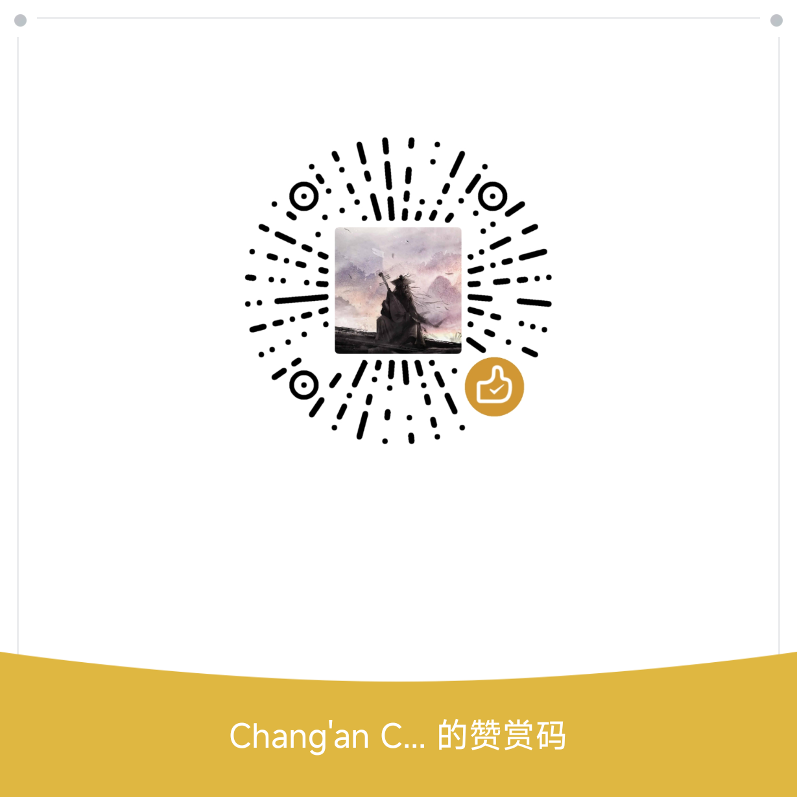

# Waylore · 客行录

A free, local-first journal for Windows, Android and Linux. Keep journeys, tickets, meals, films and personal scrapbooks in one place.

[Download both clients · 1.0.0](https://github.com/changanhe1205-afk/kexinglu/releases/latest) · [Website](https://waylore-kexinglu.fonddill9.chatgpt.site/en.html) · [简体中文](README.md)

## In this update

- Full-screen mobile maps, portrait/landscape switching, pan and zoom, with zoom-aware vector routes and markers.
- Optional email and GitHub sign-in with cloud sync. Other integrated providers appear only after backend configuration.
- Language selection: Simplified Chinese, Traditional Chinese, English and Japanese. Common navigation, account, profile, map and editing labels are localized. Some advanced scrapbook copy, dynamic summaries and built-in place names remain Chinese. Your personal content is never automatically translated.
- Inline collection-card flips, floating frosted navigation, editable profiles and covers.
- A birthday greeting on the matching local calendar day, shown once per account per device per day.

Install over the existing app to keep local data. Back up important records before updating. Public versions remain 1.0.0; Android uses an increasing internal build number.

[Native HarmonyOS phone and tablet port](harmony/README.md): the 1.0.0 AppGallery package has been compiled, signed and signature-verified. Compatibility testing and store preparation are in progress; it has not been published on AppGallery.

## Optional support

A GitHub star, a suggestion or an optional contribution helps this independent project grow. Contributions do not unlock features or affect access. Thank you for keeping Waylore moving forward.

[Social sign-in setup](docs/SOCIAL_LOGIN.md) · [Data and usage notes (Chinese)](docs/USAGE.md)

### Android tablets & Linux / 平板与 Linux

Android 1.0.0 supports phones, tablets, rotation and split-screen with one APK. Large windows show journals and maps side by side. Linux 1.0.0 packages target Ubuntu 22.04+ x64: DEB installer and portable TAR.GZ. See [Linux instructions](docs/LINUX.md).

安卓手机和平板使用同一 APK。Linux 安装说明见上方链接；所有安装包统一在 [Releases](https://github.com/changanhe1205-afk/kexinglu/releases/latest) 和官网提供。
