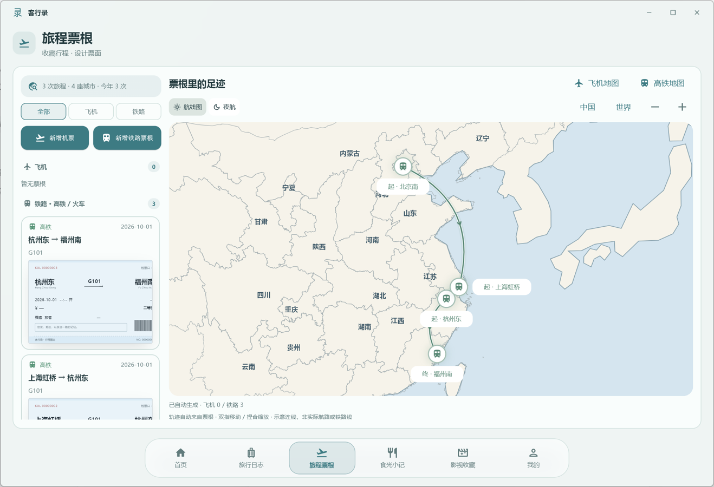
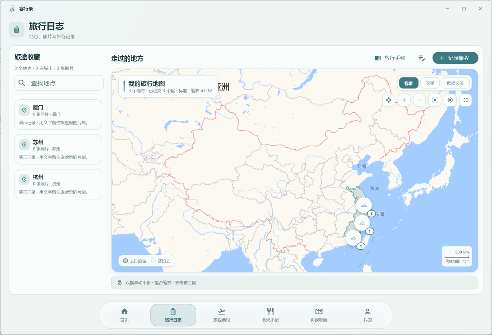

<div align="center">


# 客行录 · Kexinglu

**把走过的路、尝过的味道、看过的故事，留给以后的自己。**

一款支持 Windows 与 Android 的本地优先生活记录应用。旅行日志、旅程票根、自由手账、食光小记与影视收藏，在一个安静的空间里慢慢积累。

[下载 Windows / Android 1.0.0](https://github.com/changanhe1205-afk/kexinglu/releases/latest) · [English](README.en.md) · [使用与数据说明](docs/USAGE.md) · [更新记录](CHANGELOG.md)

</div>

## 手机与电脑，一起记录

- **两端版本均为 1.0.0**，Android 使用递增内部构建号，支持保留数据覆盖安装。
- 手机端地图可全屏横竖切换、拖动和缩放；轨迹线、地点标记与文字随缩放重新绘制。
- 邮箱登录与可选云同步；GitHub 登录已启用，其他第三方服务按后台配置显示。[登录配置说明](docs/SOCIAL_LOGIN.md)
- 简体中文、繁体中文、English、日本語界面语言入口。常用导航、资料、账号、地图与编辑操作已本地化；部分高级手账文案、动态统计和内置地名仍以中文显示，个人记录不做自动翻译。
- 生日当天按手机当地日期展示祝福，同一账号在该设备当天只展示一次。

[访问下载网站](https://waylore-kexinglu.fonddill9.chatgpt.site) · [支持开发者](docs/SUPPORT.md)

## 界面预览

以下为演示数据，不含个人记录。





## 记录，不止一种方式

| 模块 | 可以做什么 |
| --- | --- |
| 旅行日志 | 按地点保存文字与照片，在地图上回看旅途，支持触控板平移与缩放。 |
| 旅程票根 | 收藏飞机、高铁与火车票根；选择票面样式、翻看正反面；根据票根自动绘制弧形轨迹。 |
| 旅行手账 | 自愿创建空白手账或从旅行记录整理；全屏自由编辑文字、照片与贴图，拖动排版、切换纸张与封面，翻页浏览并导出 HTML 手账。 |
| 食光小记 | 记录餐厅、食物、图片和感受，为每次味觉记忆留一页。 |
| 影视收藏 | 保存电影与剧集、海报、评分和观后感，以动态陈列和自动轮播回顾收藏。 |
| 外观 | 12 套主题、9 张内置背景，支持导入自己的背景；保留浮动毛玻璃导航。 |

票根支持 41 个航空公司选项、140 个机场离线坐标，以及 2,917 个铁路站点离线坐标。地图是纪念性轨迹示意，不是实际航路、铁路运行线路或导航工具；未覆盖的站点可能按城市近似定位或显示待定位。

## 安装

1. 在 [Releases](https://github.com/changanhe1205-afk/kexinglu/releases) 下载 `Kexinglu-Setup-1.0.0.exe`。
2. 退出正在运行的客行录，运行安装包；默认建立桌面快捷方式，也可以取消勾选。
3. 启动后直接记录，无需创建应用账号。核心记录功能可以离线使用。

发布包面向 **Windows 10 / 11 x64**，内含 Python 与桌面运行组件，不需要另装 Python。当前版本未做商业代码签名，Windows 可能显示“未知发布者”；可使用发布页的 `SHA256SUMS.txt` 校验下载文件。

此前的 `2.x` 为开发迭代编号，`1.0.0` 是首个公开发行版，包含此前的改进；安装标识与用户数据格式保持兼容。升级无需先卸载。卸载应用不会主动删除用户记录。

## 本地数据与联网功能

记录、图片和设置保存在本机，没有应用账号或云同步。默认数据目录为 `%LOCALAPPDATA%\客行录`，也支持沿用旧版或用户自选目录；配置位于 `%APPDATA%\客行录\settings.json`。

“本地记录”不代表所有功能都不联网：天气和城市定位、在线地图瓦片需要外部服务。可选 AI 票根识别会把你选择的截图发送给自己配置的模型服务商；API Key 保存在本地配置文件中，未加密。请不要分享包含该配置的备份。详见 [使用与数据说明](docs/USAGE.md)。

## 从源码运行

已验证环境：**Python 3.14 x64、Flet 1.0.1**。请使用独立虚拟环境。

```powershell
git clone https://github.com/changanhe1205-afk/kexinglu.git
cd kexinglu
py -3.14 -m venv .venv
.\.venv\Scripts\python.exe -m pip install -r requirements.txt
.\.venv\Scripts\python.exe main.py
```

首次配置开发环境需要联网下载依赖及 Flet 桌面运行组件。开发版默认使用项目中的 `data/`，与安装版配置分开。

```powershell
# 自动测试
.\.venv\Scripts\python.exe -m unittest discover -s tests -p "test_*.py"
# 构建应用
.\.venv\Scripts\python.exe build.py
# 安装 Inno Setup 6，并确保其包含 ChineseSimplified.isl 语言文件
# 如果没有安装在常见目录，设置 $env:INNO_SETUP_DIR
.\.venv\Scripts\python.exe build_installer.py
```

完整依赖版本已固定，便于复现本次发行。原生交互测试需要 Windows 桌面会话，不能在无桌面的环境中直接运行。

## 反馈与资源来源

欢迎通过 [Issues](https://github.com/changanhe1205-afk/kexinglu/issues) 提交问题或建议。请附上软件版本、Windows 版本、操作步骤，并在截图中遮盖姓名、证件号和行程等私人内容；不要上传数据库或 API Key。

地图与航空、铁路数据来源见 [THIRD_PARTY_NOTICES.md](THIRD_PARTY_NOTICES.md)。源码公开不改变第三方资源各自的权利与使用条件。

## 支持这个小作品

客行录免费提供使用。一个 Star、一条建议，或一份随心的赞赏，都是继续打磨它的动力。赞赏完全自愿，不解锁功能，不影响正常使用。谢谢你，让这个小作品走得更远。


